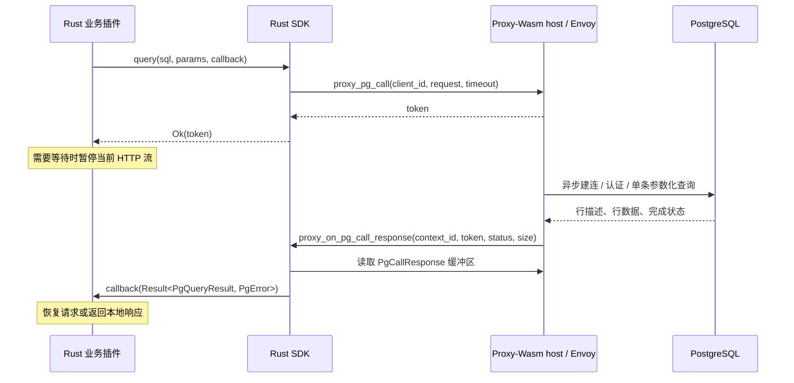

# Higress 2.2.6：Rust Wasm 异步直连 PostgreSQL 技术方案

日期：2026-11-26。状态：已按用户授权完成本地代码实现，并通过 macOS/WAMR 自编译宿主到 Docker PostgreSQL 的明文及 StartTLS 数据面测试；Linux/V8 完整网关和部署镜像尚未构建。实施、补丁和证据入口见第 14 节。

## 1. 已确认的需求与范围

- 参照 Redis 的 `proxy_redis_call` 路线，由 Envoy 宿主异步直连 PostgreSQL，不引入 HTTP 桥接服务。
- 允许修改 `higress/plugins/wasm-rust`、本地 `proxy-wasm-rust-sdk`、Envoy 和 Proxy-Wasm C++ host，并重新编译网关。
- 每次提交一条查询 SQL；支持参数绑定与完整结果集回调；不提供跨调用事务接口。
- 首期以返回行集的查询为目标，不增加独立 `execute()` 写入 API；“单条语句”不等于只读权限，数据库侧权限由所用角色决定。
- 实现期间可以自行克隆必要仓库；固定基线提交，不直接追踪远端分支最新版本。

第 1—13 节记录设计约定，最终接口与验证结果见第 14 节及实现 README。新增能力依赖本次定制宿主，原版 Higress 2.2.6 不包含 PG ABI。

## 2. 当前基线与仓库准备

以下 SHA 从本地仓库及其锁定依赖核对，作为实施基线。

| 组件 | 本地位置／来源 | 基线提交 | 用途 |
| --- | --- | --- | --- |
| Higress | `higress/` | `1fef633553462434ccafad94a6ef35d2b367450f` | 2.2.6，Rust 上层 SDK、构建和网关打包 |
| Rust 底层 SDK | `proxy-wasm-rust-sdk/` | `8c902102091698bec953471c850bdf9799bc344d` | hostcall、回调分发、缓冲区类型 |
| Envoy | `higress/envoy/envoy/` | `0b37c366dfc09c0d780e4b1dc5b6a92b6c992ce6` | PG 异步客户端、Wasm Context |
| Istio Proxy | `higress/istio/proxy/` | `919836551144ad42c41bbe25597d74c1b9cb8421` | Envoy 构建入口 |
| Proxy-Wasm C++ host | `higress-group/proxy-wasm-cpp-host` | `d9c558753df6781388e36e0d51adc98c0b6835a0` | 新增宿主 ABI、Wasm 导出回调 |

Envoy 和 Istio Proxy 目前仅存在空子模块目录。C++ host 的基线来自上述 Envoy 提交的 `bazel/repository_locations.bzl`，不能独立升级至 master。

实施准备步骤：

1. 初始化 Higress 已声明的 Envoy 和 Istio Proxy 子模块，确认检出的 SHA 与本表一致；根据实际构建链再初始化 Istio 等所需子模块。
2. 在工作区内克隆 `https://github.com/higress-group/proxy-wasm-cpp-host`，检出本表提交。
3. 阅读新仓库及子目录内适用的 `AGENTS.md`，确认实际 Redis ABI 定义和构建目标后再修改。
4. 开发构建通过 Bazel repository override 接入本地 C++ host；若容器内构建，必须挂载该路径并使用容器内绝对路径。
5. 可分发构建改为固定修改后的 host 提交与归档 SHA-256，保留依赖补丁配置；不能只依赖开发机器上的 override。
6. Rust 侧采用 Cargo source patch 接入本地 SDK，并检查每个验证插件的依赖图。各插件是独立 Cargo 包，其顶层 manifest 需要对应 patch，不能假设 SDK 内的 patch 自动传播。

初步准备命令，执行位置为工作区根目录；本次未执行：

```sh
git -C higress submodule update --init envoy/envoy istio/proxy
git clone https://github.com/higress-group/proxy-wasm-cpp-host proxy-wasm-cpp-host
git -C proxy-wasm-cpp-host checkout d9c558753df6781388e36e0d51adc98c0b6835a0
git -C higress/envoy/envoy rev-parse HEAD
git -C higress/istio/proxy rev-parse HEAD
git -C proxy-wasm-cpp-host rev-parse HEAD
```

## 3. 复用 Redis 的结构，补齐 PG 专属能力

现有 Redis 的真实链路是：`RedisClient` 编码 RESP → Rust hostcall → Envoy `redisAsyncClient()` → 宿主回调 → Rust dispatcher → 解析响应。

复用其调用模式和上下文管理方式，不能复用 Redis 网络客户端或 RESP 解析器。PG 需要握手认证、连接级状态机以及结果边界处理。



所有 socket 事件、定时器及完成处理均在 Envoy worker dispatcher 上执行。不在 worker 上运行阻塞数据库调用，也不在 Wasm 内引入 Tokio 网络运行时。

## 4. 宿主 ABI 契约

采用 Higress 私有 ABI 扩展，保留所有已有接口和枚举值。PG 请求与响应使用带版本的 UTF-8 JSON v1；PG 线上通信仍使用原生二进制协议。这样首期便于跨语言核对与错误诊断，代价是序列化及内存复制开销。

### 4.1 初始化

拟定 ABI：

```c
WasmResult proxy_pg_init(
    const char* upstream, uint32_t upstream_size,
    const uint8_t* config, uint32_t config_size,
    uint32_t* return_client_id);
```

`upstream` 是 Envoy cluster 名称，不接受由 SQL 参数提供的任意地址。`config` 包括协议版本、username、password、database、建连超时、TLS 模式、连接池和结果限制。

- 返回 VM/root 配置作用域内的 `client_id`，而不是只以 cluster 为键保存全局凭据，防止多个插件、数据库或账号互相覆盖配置。
- 同一 root 下完全相同的配置可复用客户端；重新配置产生新配置代，旧客户端在存量请求完成后回收。
- 初始化仅校验配置、cluster 与资源边界，采用懒建连；`Ok` 不代表认证成功。
- 密码不进入日志、指标标签、错误文本、派生的 `Debug` 输出或明文池标识。
- 句柄不得跨 VM、worker 或配置代使用，宿主校验句柄归属。

### 4.2 查询与完成回调

```c
WasmResult proxy_pg_call(
    uint32_t client_id,
    const uint8_t* request, uint32_t request_size,
    uint32_t timeout_ms,
    uint32_t* return_token);

void proxy_on_pg_call_response(
    uint32_t context_id, uint32_t token,
    uint32_t pg_status, uint32_t response_size);
```

- `proxy_pg_call` 同步返回值只表示是否成功接收请求。参数非法、无效句柄、队列已满等在此返回，且不注册闭包、不再回调。
- 接收成功后，若上下文持续存活，则成功、SQL 错误、认证失败和超时均只完成一次；请求上下文被销毁时取消处理且不再调用其业务闭包。
- 宿主禁止在 hostcall 返回之前同步进入 Wasm 完成回调；缓存命中、即时失败等通过 dispatcher post／after-VM-call 机制延迟交付，避免 token 尚未注册。
- `PgCallStatus` 与 ABI `WasmResult/Status` 分离，拟定：`Ok=0`、`DatabaseError=1`、`NetworkError=2`、`Timeout=3`、`AuthenticationError=4`、`ProtocolError=5`、`ResourceExhausted=6`。
- 同步包装保留宿主状态原始数值，避免未知状态被转换为 Rust 无效枚举或触发 panic；异步未知状态转换为可诊断错误。
- 新增 `PgCallResponse` 缓冲区，候选数值为 10；克隆宿主后必须确认无冲突，并用跨端测试锁定。
- 缓冲区归属本次回调，SDK 在回调期间读取并转换为拥有所有权的数据；回调退出后宿主释放。
- 完整结果只在协议恢复到 `ReadyForQuery` 且状态正确后报告成功，不能在收到 `CommandComplete` 时提前归还连接。

### 4.3 token 分配的必要调整

已核实固定版本 C++ host 的 `CalloutType` 包含 HTTP、gRPC call、gRPC stream、Redis，已用尽低两位类型空间。不能直接给 PG 增加类型 4 而继续使用 `mask=0x3`、`increment=4`。

拟将内部类型空间扩为三位，保持已有类型编号 0～3，PG 使用 4；同步修改 mask、步长、初始计数器和所有类型识别逻辑。token 对插件是 opaque 值，已有插件不应依赖具体递增数值；仍需同时回归 HTTP、gRPC 和 Redis 的路由。分配器必须检查回绕与在途冲突，不复用尚在处理的 token。

## 5. 请求、结果与 Rust 公共 API

请求示例：

```json
{
  "version": 1,
  "sql": "SELECT id, name FROM users WHERE id = $1",
  "params": [{"type_oid": 20, "value": "123"}]
}
```

参数 `value: null` 表示 SQL NULL，`""` 表示空字符串；OID 0 表示由服务端推断。首期参数和结果均使用 PG text format，连接编码固定 UTF8。SQL 与参数禁止包含协议不允许的 NUL；所有长度及整数转换检查溢出。

成功响应示例：

```json
{
  "version": 1,
  "columns": [{"name": "id", "type_oid": 20}, {"name": "name", "type_oid": 25}],
  "rows": [["123", "Alice"]],
  "command_tag": "SELECT 1"
}
```

错误响应包括 `kind`、`message`、可选 `sqlstate`。协议缺失、版本不支持、列数不匹配、非法 UTF-8 等转换为 `PgError`。错误消息不得包含密码；默认不记录 SQL、参数及原始响应。

Rust 类型设计：

```rust
pub struct PgParam {
    pub type_oid: u32,
    pub value: Option<String>,
}

pub struct PgColumn {
    pub name: String,
    pub type_oid: u32,
}

pub struct PgQueryResult {
    pub columns: Vec<PgColumn>,
    pub rows: Vec<Vec<Option<String>>>,
    pub command_tag: String,
}

pub type PgQueryCallbackFn = dyn FnOnce(Result<PgQueryResult, PgError>);
```

列按序保存，不能用列名 map 覆盖重名列。`int8`、`numeric`、时间、UUID、JSONB 等首期保留 PG 文本表示，避免精度丢失或未经声明的类型转换；`bytea` 使用 PG 文本表示，需要时另加显式解码助手。

使用方式（设计示例）：

```rust
let client = PgClientBuilder::new(&cluster, Duration::from_millis(500))
    .username("app")
    .password(password)
    .database("app_db")
    .build()?;

client.init()?; // 配置生命周期内初始化；每个 worker 按需建连
let token = client.query(
    "SELECT name FROM users WHERE id = $1",
    &[PgParam { type_oid: 20, value: Some("123".into()) }],
    Box::new(move |result| {
        // 升级业务上下文的 Weak 引用，处理结果，恢复 HTTP 流或返回响应。
    }),
)?;
```

Builder 返回配置校验错误；初始化后的客户端句柄通过内部状态共享，使 `Clone` 不会导致重复配置。业务仅在提交成功后暂停 HTTP 流；提交失败直接处理错误。SDK 不自动决定 fail-open、fail-close 或恢复请求。

## 6. Envoy PG 异步客户端

### 6.1 技术选择

首期采用 Envoy 原生网络连接、dispatcher 和 timer，加独立 PG v3 codec／认证状态机。连接从 Envoy 已发现的 cluster endpoint 选择；复用现有负载均衡、连接资源限制和 transport socket 能力。

不新增 libpq 依赖，避免额外引入 TLS 库和构建链；不把已有 PostgreSQL network filter 误当成主动访问数据库的客户端。PG 语义连接池由新客户端管理，不将未经认证的普通 TCP 连接直接作为可用数据库会话。

预期模块：`envoy/postgres/async_client.h`，`source/common/postgres/` 下的客户端、连接池、codec、认证及单测。新增模块名称为建议；最终结合克隆后的 Redis 目录与 BUILD 依赖确定。

### 6.2 连接状态机

```text
Disconnected → Connecting → [TLS Negotiation] → Startup → Authenticating
             → Ready → Querying → DrainingUntilReadyForQuery → Ready
任意状态 → Failed / Closing → Closed
```

- 增量解析 PG 消息头与载荷，支持拆包、粘包、零行结果、异步 Notice 和 ParameterStatus。
- 在分配内存前校验消息长度、字段数、单字段和总结果大小；非法消息、异常状态或不支持的协议分支关闭连接。
- 正确处理 AuthenticationOk、ErrorResponse、BackendKeyData、ReadyForQuery；只有 ReadyForQuery 的 idle 状态可作为空闲连接。
- `ErrorResponse` 后持续处理到协议同步完成，不能将后续消息误投递给下一个请求。

### 6.3 单条查询与参数

使用 unnamed statement／portal：`Parse → Bind → Describe portal → Execute → Sync`；Execute 不启用分批拉取。由 Parse 限制一条语句，避免通过分号扫描破坏字符串、注释及 dollar quote。

不提供事务、预备语句缓存、pipelining、COPY、游标或订阅 API。遇到 COPY 等不支持的交换模式直接报错并关闭连接。即使调用方提交了事务控制语句，非 idle 的最终会话也不能进入连接池。

为避免 `SET`、`set_config()`、临时对象等单条语句污染复用会话，首期成功复用前执行宿主内部 `DISCARD ALL` 并等待正常 idle 状态，固定连接编码等基线设置由启动参数确定；复位失败则关闭连接。该清理是池内部行为，不向业务暴露第二条语句或事务 API。后续只有在证据证明状态隔离充分时再优化清理成本。

### 6.4 认证与 TLS

首期目标支持 SCRAM-SHA-256、MD5 和免密码认证；CleartextPassword 仅在已验证 TLS 的连接上允许。SCRAM 要核验 server signature，使用安全随机 nonce，并明确非 ASCII 密码的 SASLprep 处理；不能做仅适用于测试密码的简化认证。暂不支持 GSS、SSPI、证书认证及 SCRAM-SHA-256-PLUS，收到这些要求时返回明确错误。

TLS 目标为 PG 标准 `SSLRequest → S → TLS handshake → Startup`，使用 Envoy TLS 证书验证和 SNI。实现准备阶段核实当前版本 transport socket 的原地升级能力与 buffer 行为；若需要额外 StartTLS 适配，将其作为宿主实现任务，不静默降级明文，也不默认 PG 能接收一开始就是 TLS 的连接。`disable` 可用于明确配置的本地测试；生产配置目标为证书及主机名验证。

### 6.5 连接池、超时与资源

| 参数 | 拟定初始默认值 | 语义 |
| --- | --- | --- |
| `connect_timeout_ms` | 1000 | 覆盖 TCP、TLS、启动及认证 |
| `query_timeout_ms` | 500 | 从接收查询开始，包含排队、必要建连、查询及会话复位 |
| `max_connections` | 8 | 每 worker、每客户端配置作用域 |
| `max_pending_requests` | 128 | 对应作用域内有界等待队列 |
| `max_rows` | 1000 | 超出返回错误，不静默截断 |
| `max_response_bytes` | 1048576 | 包括最终 JSON 编码后的结果大小 |
| `max_request_bytes` | 65536 | 包括 SQL、参数及 JSON 编码 |
| `idle_timeout_ms` | 60000 | 空闲连接回收 |

这些是首期可配置默认值，不是性能结论。另设 worker 级总连接和在途内存上限，避免通过多个客户端绕过单池限额；具体值依据网关 worker 数及压测结果确定。

- 池隔离至少包含 cluster、选定 endpoint、database、username、TLS 配置、插件 root/VM 和配置代；凭据变化产生新代。
- 每连接同一时刻处理一个查询，等待队列使用 FIFO。连接断开时不自动重放查询。
- 总查询 deadline 使用单调时钟；各阶段受剩余预算约束，不在每个阶段重新获得完整 timeout。
- 排队超时移除任务；执行超时、请求销毁或结果超限时关闭执行连接并终止本地处理。首期不实现额外 CancelRequest 连接，关闭连接不宣称服务端已经立即停止执行。
- 参数结果缓存和 JSON 序列化都受预算约束，不能在完整缓存无限数据后才检查大小。
- 端点移除、cluster 更新、VM 关闭和配置热更新均需停止借出对应旧连接并完成回收。

## 7. Wasm 上下文、错误与可观测性

1. 宿主保存 token、origin context、请求对象和定时器；完成／超时／销毁通过同一终态转换竞争，保证只清理一次。
2. Rust dispatcher 注册 `token → (context_id, FnOnce)`；回调前移除映射、释放 `RefCell` 借用，确认上下文存在并成功切换 effective context 后再执行。
3. 上下文删除时移除其 PG 回调；宿主同时取消排队或关闭执行连接。迟到和重复完成仅计数，不 panic、不恢复已销毁 HTTP 流。
4. PG 使用独立请求表与回调缓冲区；完成回调中再提交 PG、Redis 或 HTTP 调用时，不能覆盖尚未读取的结果。
5. 资源通过 RAII 与 dispatcher 延迟销毁管理，避免网络回调仍持有已释放 Context 的裸指针。
6. 指标至少包含请求总量、在途数、排队数、连接数、耗时、超时、认证错误、SQL 错误、结果超限和取消数；标签采用有界 cluster/client 类型，不附 SQL、账号、参数或 token。

## 8. 具体修改清单

| 层 | 文件／模块 | 工作内容 |
| --- | --- | --- |
| Rust 底层 SDK | `src/hostcalls.rs` | PG ABI、安全包装、长度／超时检查 |
| Rust 底层 SDK | `src/dispatcher.rs` | 注册、回调导出、上下文恢复及生命周期清理 |
| Rust 底层 SDK | `src/types.rs` | 缓冲区和 PG 异步状态 |
| Higress Rust SDK | 新增 `src/pg_wrapper.rs`，修改 `src/lib.rs` | Builder、Client、参数、结果与错误 |
| Higress Rust SDK | `src/internal.rs` | PG hostcall 与缓冲区读取包装 |
| Higress Rust SDK | Cargo manifest、验证插件和 README | 本地依赖接入、使用示例及文档 |
| C++ host | `include/proxy-wasm/`、`src/` 对应 ABI/Context/Wasm 实现 | 导入注册、内存校验、回调发现与调用、token 类型 |
| Envoy | `source/extensions/common/wasm/` | PG init/call、回调缓冲区、请求生命周期 |
| Envoy | 新增 `envoy/postgres/`、`source/common/postgres/` | 非阻塞客户端、认证、codec、连接池 |
| Envoy 构建 | BUILD 与依赖锁定 | host override、归档校验及新模块链接 |
| 网关构建 | Higress 构建／打包配置 | 将新 Envoy 接入镜像，核对二进制身份 |
| 验证 | Rust、C++ 单测及独立运行 harness | 真实 PG、真实 Wasm 数据面与可复现证据 |

PG 回调在底层 dispatcher 中处理，预计无需改动上层 `PluginHttpWrapper` 的 HTTP 回调分发逻辑。若接入验证发现确有需要，限定为 PG 生命周期集成，不重构现有 Redis 功能。

## 9. 构建与交付链路

已确认 Higress 的 `make build-envoy` 调用 `tools/hack/build-envoy.sh`，使用 `external/proxy`、`external/envoy` 和容器内构建；`make build-gateway-local` 提供单架构镜像入口。

关键点：`Makefile.core.mk` 中 `ENVOY_PACKAGE_URL_PATTERN` 默认指向 v2.2.6 的已发布二进制。仅运行 gateway 构建命令可能再次打包原版 Envoy。因此实施时必须：

1. 将修改后的源码和 C++ host override 显式接入 `external/` 构建目录，避免误编译副本。
2. 使用单架构构建验证，记录 build-tools 镜像 digest、Bazel 配置和完整命令；通过后再按需要补其他架构。
3. 将本地生成的 Envoy 归档接入网关打包路径；最终方式根据实际打包脚本确认，禁止用未验证的参数假定已替换成功。
4. 对编译二进制、归档内二进制和容器内实际运行二进制逐一核对 SHA-256，并记录 gateway 镜像 digest。
5. Rust 验证插件使用 `wasm32-wasip1`，锁定两个 SDK 的实际依赖来源，记录 Wasm SHA-256。
6. 在 macOS 使用匹配架构的 Linux 构建／运行容器。方案阶段不执行耗时编译，不发布镜像或改动现有运行网关。

原网关不具备新增 ABI，加载使用 PG hostcall 的插件应得到明确不兼容结果；新网关必须继续运行原有 HTTP、Redis 和 gRPC 插件。不能承诺新插件在原版 2.2.6 网关上可用。

## 10. 验证计划与验收标准

### 10.1 静态与 SDK 检查

对修改后的底层 SDK 与上层 SDK 分别执行格式检查、clippy、单元测试与 Wasm 目标编译；按各 Cargo 包实际布局指定 manifest。基础命令为 `cargo fmt --all -- --check`、`cargo clippy --all-targets -- -D warnings`、`cargo test --lib`、`cargo check --target wasm32-wasip1`。如果基线存在无关告警，先记录基线，不将其误称为本次新增失败。

有意义的 SDK 用例包括：无效配置、超时溢出、JSON 错误、NULL/空串、大整数精度、重名列、SQLSTATE、提交失败不泄漏闭包、嵌套回调、上下文提前删除和未知 token。

### 10.2 C++ 单测与协议验证

- ABI 内存指针、长度、句柄归属、空结果、未知状态、token 回绕及四类原有 callout 路由。
- 协议拆包／粘包、认证成功与失败、SCRAM server signature 错误、异常消息、ErrorResponse 后同步、ReadyForQuery 非 idle、会话复位。
- TCP 断开、TLS 失败、排队／认证／执行／复位超时、取消与网络完成竞争、端点移除、VM 销毁。
- 在适用构建中运行 ASan／UBSan，检查认证缓冲、消息长度及回调生命周期；对 codec 增加有界异常输入测试。

克隆源码后按真实 BUILD 文件列出并锁定 Bazel 测试目标和命令，不在本设计中伪造尚未核实的 target。

### 10.3 真实数据面验证矩阵

在独立 Compose／本地 harness 中运行自编译网关、Rust 验证插件、真实 PostgreSQL 和 HTTP 上游。主验证版本拟为 PG 16，再补 PG 17 的协议兼容冒烟；实施时锁定具体 patch 版本与镜像 digest，不使用浮动 latest。

| 场景 | 预期 |
| --- | --- |
| `SELECT 1`、零行结果、NULL、空字符串、Unicode、重名列 | 行列及值精确匹配 |
| `$1` 参数、类型推断、int8、numeric、JSONB、bytea | 不拼 SQL，不丢精度，不错误解码 |
| 含分号的字符串／注释、两条独立语句 | 合法单条语句成功；多语句由 Parse 拒绝 |
| SQL 语法错误、无表、权限不足 | 回调带正确 SQLSTATE，HTTP 流有确定结束行为 |
| 错误密码、SCRAM／MD5／trust、有效及无效 TLS | 认证与 TLS 行为符合配置 |
| `pg_sleep`、服务端断连、结果超限、池饱和 | 有界完成，正确错误类型，无无限缓冲 |
| HTTP 客户端提前断开、VM／配置重载 | 无无效上下文调用，无连接和闭包泄漏 |
| 并发 PG 与 Redis／HTTP／gRPC | token 与回调不串线，无重复恢复 |
| 连接复用、SET／会话状态改变 | 下一查询不继承前一请求的会话状态 |

验收必须同时提供：源码 SHA、host 依赖 SHA、构建命令、Envoy／Wasm 哈希、镜像 digest、配置与 SQL、预期／实际响应、日志与指标、重复运行结果和清理证明。清理只处理本 harness 创建的容器、卷、端口与文件。

原版网关作为兼容性基线，记录其缺少 PG ABI 的结果；修改后的网关完成真实查询。该对照用于证明能力新增及运行产物身份，不将预期的不支持描述为原版软件缺陷。

完成标准：PG 单条参数化查询经过真实 Wasm 数据面返回正确结果；所有错误分支有界结束；已有 Redis／HTTP／gRPC 回归通过；部署产物身份可核验；测试资源清理完成。

## 11. 实施阶段与风险收敛

1. **准备**：补齐仓库、固定 SHA、读取约束、确认 ABI 枚举、token 空间及 TLS 升级方式。
2. **ABI 与 SDK**：建立 hostcall、缓冲区、dispatcher 和 Rust 上层类型，使用宿主测试替身验证闭环；此阶段不宣称可直连。
3. **PG 客户端**：实现协议 codec、认证、异步建连和查询，再补齐连接池、复位、deadline 和资源限制。
4. **宿主集成**：打通 Context、线程作用域、cluster 更新和 VM 生命周期，回归所有 callout。
5. **真实构建**：编译本地 Envoy、Rust 插件和网关镜像，核对打包链路。
6. **验收交付**：完成验证矩阵、修正问题、交付跨仓库补丁及证据。

主要工程风险是 TLS 升级接入、SCRAM 完整实现、回调销毁竞争、连接池会话隔离和实际打包产物一致性。这些均纳入实现与验收任务，不以“只新增 SDK 接口”替代。

方案编写阶段未执行 clone；后续本地实施已补齐第 2 节的固定源码。TLS 适配的具体 C++ 文件、Bazel 测试目标及容器挂载参数在固定源码检出后补充，技术方向和验收要求保持上述约定。

## 12. 仓库贡献流程边界

本文保存在工作区根目录，作为用户请求的本地方案，不作为 Higress issue-spec 审批文件，也不在插件目录创建替代 Design Issue 的文档。

若后续工作用于 Higress 上游贡献，需遵守 `higress/AGENTS.md` 与 `docs/developers/agent-assisted-contributions.md`：适用的代理辅助贡献在实质实现前需具备维护者批准的 Proposal、Design 及获授权 TASK；验证和 PR 需附可追溯证据。已核验维护者例外按该政策执行。用户已授权技术修改范围，不据此假定上游审批已经完成。

## 13. 参考资料

- 本地基线：`higress/plugins/wasm-rust/src/redis_wrapper.rs`、`src/internal.rs`、本地 `proxy-wasm-rust-sdk/src/hostcalls.rs`／`dispatcher.rs`／`types.rs`。
- [固定 Envoy 的 Wasm Context](https://github.com/higress-group/envoy/blob/0b37c366dfc09c0d780e4b1dc5b6a92b6c992ce6/source/extensions/common/wasm/context.cc)：Redis 宿主路径和回调处理参考。
- [固定 Envoy 的依赖清单](https://github.com/higress-group/envoy/blob/0b37c366dfc09c0d780e4b1dc5b6a92b6c992ce6/bazel/repository_locations.bzl)：C++ host 仓库及版本来源。
- [固定 C++ host 的 Wasm 定义](https://github.com/higress-group/proxy-wasm-cpp-host/blob/d9c558753df6781388e36e0d51adc98c0b6835a0/include/proxy-wasm/wasm.h)：token 类型空间与 after-VM-call 参考。
- [PostgreSQL 16 协议流程](https://www.postgresql.org/docs/16/protocol-flow.html)：握手、扩展查询、单语句限制和完成边界。
- [PostgreSQL 16 SASL 认证](https://www.postgresql.org/docs/16/sasl-authentication.html)：SCRAM 消息与验证要求。

## 14. 本地实施与证据入口

用户随后明确授权本地定制跳过仓库上游审批流程，已按本方案开始实现；不将此授权表述为维护者批准，也未提交或发布上游贡献。

实现、复现命令、固定依赖与验证边界统一记录在 [tools/pg-dev/README.md](../../tools/pg-dev/README.md)。真实 PostgreSQL 的 Docker 明文及 TLS 协议测试结果分别保存在 `pg-dev/evidence/docker/`、`pg-dev/evidence/docker-tls/`；Envoy/Wasm 数据面须以独立构建及运行记录验收，不能用 codec 协议测试替代。原设计章节保留为设计时记录，最新实施状态以该 README 和证据文件为准。

本地实施验收记录（2026-11-26）：

- Rust SDK 测试 18 项及 Clippy 通过；新增验证插件已构建为 Wasm。
- 生产 codec 8 项及 ASan/UBSan、Bazel 异步生命周期 4 项通过。
- 自编译 macOS/WAMR 宿主通过真实 Wasm 到 PostgreSQL 16.6 的明文及 StartTLS 两组各 12 项数据面检查。
- 既有 Wasm NullVm 44 项、HTTP/Redis/gRPC 所在的 Wasm filter NullVm 90 项通过。
- PostgreSQL 17.2 明文协议兼容冒烟通过；所有专用数据库容器与数据面宿主已清理。
- 完整 Linux/V8 Higress 网关及镜像未构建，不能将上述验证扩展表述为该部署产物已经验收。官方 ARM64 构建环境镜像已下载并记录 digest。

## 15. 个人 fork 发布与依赖锁定

用户授权将本次改动提交至 `charlesvhe`，统一使用 `feat/async-postgres-2.2.6` 功能分支。

| 仓库 | 固定依赖提交／检出方式 |
| --- | --- |
| `charlesvhe/higress` | 本功能分支；根提交包含上层 SDK、Envoy 子模块指针、本文和 `tools/pg-dev/` |
| `charlesvhe/envoy` | `4d0b989a8f91f74d1985eb5f655819e312d8f964`，通过 `.gitmodules` 和 gitlink 锁定 |
| `charlesvhe/proxy-wasm-rust-sdk` | `339466a0ceec01e5a7d05347e9d86f57c1daa218`，全部 Rust 包使用同一 Git rev 和锁文件 |
| `charlesvhe/proxy-wasm-cpp-host` | `dec0d9632dbf523c67a93abbfbb220444802bb9e`，Envoy Bazel 固定源码归档及 SHA-256 |

复现步骤见 [验证资料 README](../../tools/pg-dev/README.md)，机器可读索引见 [published-revisions.json](../../tools/pg-dev/published-revisions.json)。构建定制网关应使用其中的源码构建入口；原版预编译 Envoy 不包含 PG ABI。

发布归档保留首次运行的日志、Wasm／Envoy 哈希和本机路径。`source-manifest.json`／`patches/` 对应发布前已测试的本地源码快照；依赖由本地 path 改为固定个人 Git rev 后的复测记录单独位于 `evidence/publication/`。
